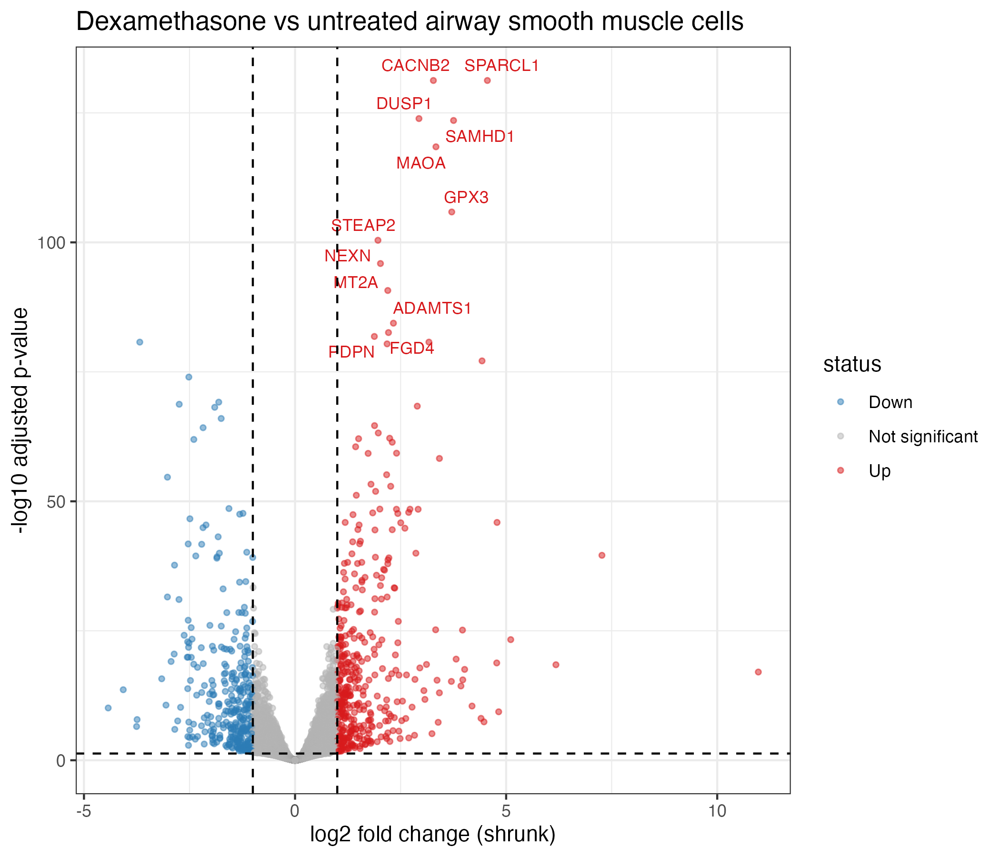

# Dexamethasone response in airway smooth muscle: RNA-seq differential expression

Differential expression and GO enrichment analysis of GEO dataset GSE52778
(Himes et al. 2014) using DESeq2 and clusterProfiler in R.

## Key results
- 2,190 genes up and 1,891 down with dexamethasone (adjusted p < 0.05)
- Known glucocorticoid-responsive genes (DUSP1, PER1) recovered
- GO enrichment highlighted MAPK cascade regulation

## Contents
- [Full report](rnaseq_report.md)
- `rnaseq_report.qmd`: reproducible source
- `figures/`: PCA, heatmap, volcano, GO dotplot
- `results/`: DESeq2 and GO result tables, session info

## Reproduce
Open the RStudio project, install the packages listed in the report, and render `rnaseq_report.qmd`.