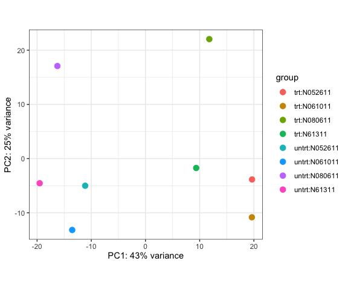
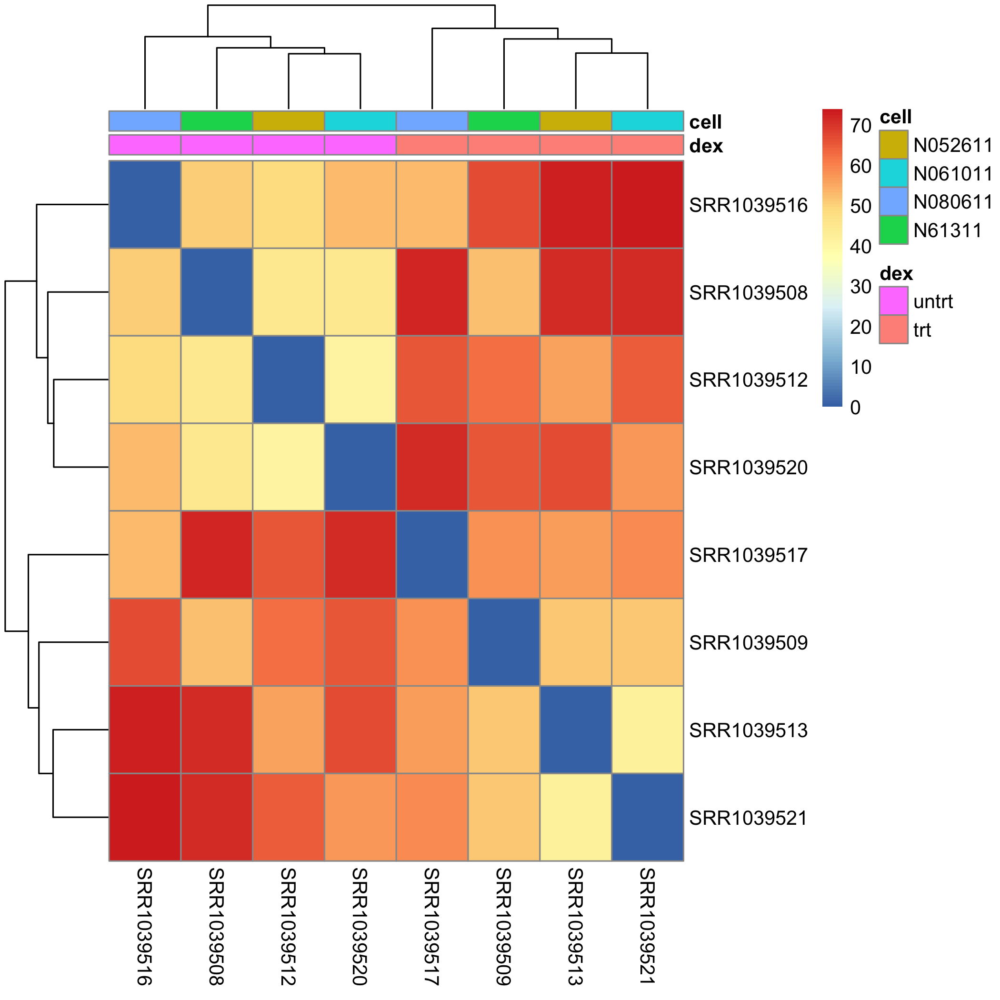
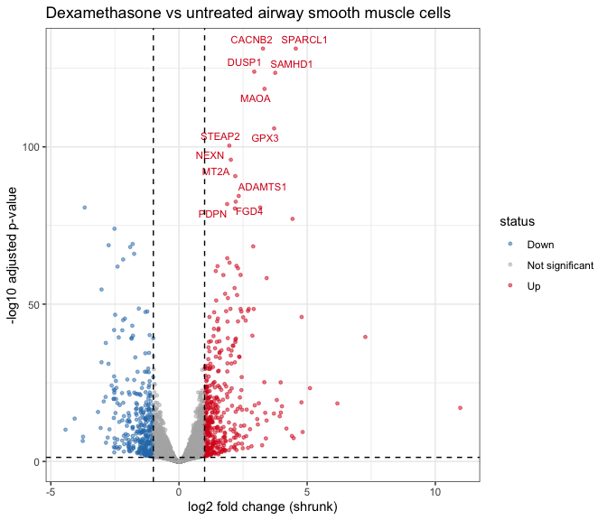
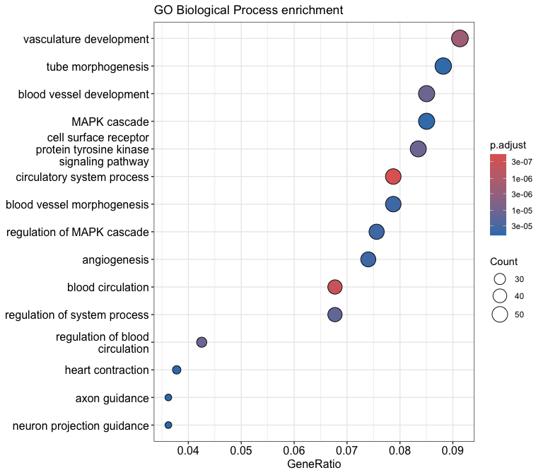

# Differential expression in dexamethasone-treated airway smooth muscle cells
AMY GAO
2026-10-15

# Background and aim

Glucocorticoids such as dexamethasone are widely used to treat asthma
and other inflammatory airway diseases. This report re-analyses the
public RNA-seq dataset of Himes et al. (2014), available on GEO as
**GSE52778** and packaged in Bioconductor as `airway`. It contains eight
samples from four primary human airway smooth muscle cell lines, each
either untreated or treated with dexamethasone.

**Aim:** identify genes whose expression changes after dexamethasone
treatment, and describe the biological processes they are involved in.

# Methods overview

Raw read counts were filtered to remove lowly expressed genes, and
differential expression was tested with DESeq2 using the design
`~ cell + dex`. This compares treated with untreated samples while
accounting for differences between the four cell lines (each cell line
was measured in both conditions). Fold changes were shrunk with the
`apeglm` method. Genes were called significant at an adjusted p-value
(Benjamini-Hochberg) below 0.05 and an absolute log2 fold change
above 1. Gene Ontology (Biological Process) over-representation was
tested with `clusterProfiler`, using all genes that were tested for
differential expression as the background.

# 1. Setup

``` r
library(DESeq2)
library(airway)
library(tidyverse)
library(pheatmap)
library(ggrepel)
library(org.Hs.eg.db)
library(clusterProfiler)
library(enrichplot)

dir.create("figures", showWarnings = FALSE)
dir.create("results", showWarnings = FALSE)
```

# 2. Data

``` r
data("airway")
se <- airway
se$dex <- relevel(se$dex, ref = "untrt")   # untreated is the baseline

knitr::kable(
  as.data.frame(colData(se))[, c("SampleName", "cell", "dex")],
  caption = "Samples in the airway dataset (dex = dexamethasone; trt = treated, untrt = untreated)"
)
```

|            | SampleName | cell    | dex   |
|:-----------|:-----------|:--------|:------|
| SRR1039508 | GSM1275862 | N61311  | untrt |
| SRR1039509 | GSM1275863 | N61311  | trt   |
| SRR1039512 | GSM1275866 | N052611 | untrt |
| SRR1039513 | GSM1275867 | N052611 | trt   |
| SRR1039516 | GSM1275870 | N080611 | untrt |
| SRR1039517 | GSM1275871 | N080611 | trt   |
| SRR1039520 | GSM1275874 | N061011 | untrt |
| SRR1039521 | GSM1275875 | N061011 | trt   |

Samples in the airway dataset (dex = dexamethasone; trt = treated, untrt
= untreated)

The count matrix contains 63677 genes (rows) across 8 samples (columns).
Values are raw, un-normalised read counts, which is the input DESeq2
requires.

# 3. Filtering

``` r
dds <- DESeqDataSet(se, design = ~ cell + dex)

n_before <- nrow(dds)
keep <- rowSums(counts(dds) >= 10) >= 4   # at least 10 reads in at least 4 samples
dds <- dds[keep, ]
n_after <- nrow(dds)
```

Genes were kept if they had at least 10 reads in at least 4 of the 8
samples. This reduced the dataset from 63677 to 16139 genes, because
genes with almost no reads cannot be tested reliably.

# 4. Quality control

Before testing, I checked whether samples group sensibly. Counts were
transformed with the variance-stabilising transformation (VST) for
visualisation only; the statistical testing below uses the raw counts.

``` r
vsd <- vst(dds, blind = TRUE)

pca_plot <- plotPCA(vsd, intgroup = c("dex", "cell")) + theme_bw()
ggsave("figures/pca.png", pca_plot, width = 6, height = 5, dpi = 300)
pca_plot
```



PC1 (43% of variance) clearly separates dexamethasone-treated from
untreated samples, with all four treated samples on the right and all
four untreated on the left, while PC2 (25%) mainly separates the cell
lines, with N080611 sitting apart from the other three. No sample
appears to be an outlier.

``` r
sample_dists <- dist(t(assay(vsd)))
pheatmap(
  as.matrix(sample_dists),
  annotation_col = as.data.frame(colData(vsd)[, c("dex", "cell")]),
  filename = "figures/sample_distance_heatmap.png"
)

```


Samples cluster first by treatment, with the four untreated and four
treated samples forming two distinct groups, and within each group the
cell lines cluster in the same order, with N080611 the most distinct.
This confirms that dexamethasone is the dominant source of variation and
supports accounting for cell line in the design.

# 5. Differential expression

``` r
dds <- DESeq(dds)

res <- results(dds, contrast = c("dex", "trt", "untrt"), alpha = 0.05)
resLFC <- lfcShrink(dds, coef = "dex_trt_vs_untrt", type = "apeglm")

n_up   <- sum(res$padj < 0.05 & res$log2FoldChange > 0, na.rm = TRUE)
n_down <- sum(res$padj < 0.05 & res$log2FoldChange < 0, na.rm = TRUE)
```

At an adjusted p-value below 0.05, 2190 genes were higher and 1891 genes
were lower in dexamethasone-treated cells.

``` r
res_df <- as.data.frame(resLFC) |>
  rownames_to_column("ensembl") |>
  mutate(symbol = mapIds(org.Hs.eg.db, keys = ensembl,
                         column = "SYMBOL", keytype = "ENSEMBL",
                         multiVals = "first")) |>
  arrange(padj)

write_csv(res_df, "results/deseq2_results_dex_vs_untreated.csv")

top_tbl <- res_df |>
  dplyr::slice_head(n = 10) |>
  dplyr::transmute(
    Gene = symbol,
    `Mean count` = round(baseMean),
    `log2 fold change (shrunk)` = round(log2FoldChange, 2),
    `Adjusted p-value` = signif(padj, 3)
  )

knitr::kable(top_tbl, caption = "Ten most significant genes (full table in results/)")
```

| Gene    | Mean count | log2 fold change (shrunk) | Adjusted p-value |
|:--------|-----------:|--------------------------:|-----------------:|
| SPARCL1 |        998 |                      4.56 |                0 |
| CACNB2  |        496 |                      3.28 |                0 |
| DUSP1   |       3412 |                      2.94 |                0 |
| SAMHD1  |      12713 |                      3.75 |                0 |
| MAOA    |       2344 |                      3.34 |                0 |
| GPX3    |      12298 |                      3.71 |                0 |
| STEAP2  |       3013 |                      1.96 |                0 |
| NEXN    |       5399 |                      2.02 |                0 |
| MT2A    |       3660 |                      2.20 |                0 |
| ADAMTS1 |      30346 |                      2.33 |                0 |

Ten most significant genes (full table in results/)

As a sanity check, the top-ranked genes include **DUSP1** and **PER1**,
both well-known glucocorticoid-responsive genes that are strongly
induced by dexamethasone.

# 6. Volcano plot

``` r
volcano_df <- res_df |>
  dplyr::filter(!is.na(padj)) |>
  mutate(status = case_when(
    padj < 0.05 & log2FoldChange >  1 ~ "Up",
    padj < 0.05 & log2FoldChange < -1 ~ "Down",
    TRUE ~ "Not significant"
  ))

top_labels <- volcano_df |>
  dplyr::filter(status != "Not significant") |>
  dplyr::slice_min(padj, n = 12)

volcano <- ggplot(volcano_df, aes(log2FoldChange, -log10(padj), colour = status)) +
  geom_point(alpha = 0.5, size = 1) +
  geom_text_repel(data = top_labels, aes(label = symbol),
                  size = 3, show.legend = FALSE) +
  scale_colour_manual(values = c(Down = "#2c7bb6",
                                 `Not significant` = "grey70",
                                 Up = "#d7191c")) +
  geom_vline(xintercept = c(-1, 1), linetype = "dashed") +
  geom_hline(yintercept = -log10(0.05), linetype = "dashed") +
  labs(title = "Dexamethasone vs untreated airway smooth muscle cells",
       x = "log2 fold change (shrunk)", y = "-log10 adjusted p-value") +
  theme_bw()

ggsave("figures/volcano.png", volcano, width = 7, height = 6, dpi = 300)
volcano
```



``` r
n_sig_lfc <- sum(volcano_df$status != "Not significant")
n_sig_up <- sum(volcano_df$status == "Up")
n_sig_down <- sum(volcano_df$status == "Down")
```

Applying both thresholds (adjusted p \< 0.05 and \|log2 fold change\|
\> 1) gives 749 genes, of which 411 are up-regulated and 338
down-regulated. These cut-offs are conventions rather than biological
rules.

# 7. Gene Ontology enrichment

``` r
sig_genes <- volcano_df |>
  dplyr::filter(padj < 0.05, abs(log2FoldChange) > 1) |>
  pull(ensembl)
universe <- volcano_df$ensembl   # every gene that was tested

ego <- enrichGO(
  gene = sig_genes, universe = universe,
  OrgDb = org.Hs.eg.db, keyType = "ENSEMBL",
  ont = "BP", pAdjustMethod = "BH",
  pvalueCutoff = 0.05, qvalueCutoff = 0.2, readable = TRUE
)

write_csv(as.data.frame(ego), "results/go_bp_enrichment.csv")

go_tbl <- as.data.frame(ego) |>
  dplyr::slice_head(n = 10) |>
  mutate(FoldEnrichment = round(FoldEnrichment, 2),
         p.adjust = signif(p.adjust, 3)) |>
  dplyr::select(Term = Description, GeneRatio, BgRatio, FoldEnrichment, p.adjust)

knitr::kable(go_tbl, caption = "Top 10 enriched GO Biological Process terms")
```

|  | Term | GeneRatio | BgRatio | FoldEnrichment | p.adjust |
|:---|:---|:---|:---|---:|---:|
| GO:0003013 | circulatory system process | 50/635 | 332/11622 | 2.76 | 2.00e-07 |
| GO:0008015 | blood circulation | 43/635 | 270/11622 | 2.91 | 3.00e-07 |
| GO:0001944 | vasculature development | 58/635 | 460/11622 | 2.31 | 2.00e-06 |
| GO:0007169 | cell surface receptor protein tyrosine kinase signaling pathway | 53/635 | 425/11622 | 2.28 | 1.17e-05 |
| GO:0001568 | blood vessel development | 54/635 | 441/11622 | 2.24 | 1.21e-05 |
| GO:1903522 | regulation of blood circulation | 27/635 | 146/11622 | 3.38 | 1.21e-05 |
| GO:0044057 | regulation of system process | 43/635 | 318/11622 | 2.47 | 1.63e-05 |
| GO:0048514 | blood vessel morphogenesis | 50/635 | 413/11622 | 2.22 | 4.02e-05 |
| GO:0043408 | regulation of MAPK cascade | 48/635 | 392/11622 | 2.24 | 4.18e-05 |
| GO:0001525 | angiogenesis | 47/635 | 380/11622 | 2.26 | 4.18e-05 |

Top 10 enriched GO Biological Process terms

``` r
go_plot <- dotplot(ego, showCategory = 15) +
  ggtitle("GO Biological Process enrichment")
ggsave("figures/go_dotplot.png", go_plot, width = 8, height = 7, dpi = 300)
go_plot
```



Enriched terms included circulatory system process, blood circulation,
vasculature development and regulation of the MAPK cascade. The MAPK
term contains DUSP1, DUSP5, DUSP8 and DUSP10, which encode phosphatases
that switch off MAPK signalling; induction of DUSP1 is a described
mechanism of glucocorticoid anti-inflammatory action. Broad terms such
as “circulatory system process” are partly driven by ion-channel genes
(for example KCND2, SCN1B and CACNA1G) that are annotated to cardiac
physiology, so I treat these terms as descriptive rather than as
evidence of vascular effects in airway smooth muscle.

A small fraction of Ensembl IDs could not be mapped to Entrez IDs
(roughly 5% of significant genes and 12% of the tested background) and
were dropped by `clusterProfiler`.

# 8. Key findings

``` r
top5 <- paste(head(res_df$symbol, 5), collapse = ", ")
```

- After filtering, 16139 genes were tested for differential expression.
- 2190 genes increased and 1891 genes decreased with dexamethasone
  (adjusted p \< 0.05); 749 also passed the \|log2 fold change\| \> 1
  threshold.
- The five most significant genes were SPARCL1, CACNB2, DUSP1, SAMHD1,
  MAOA. Known glucocorticoid-responsive genes (DUSP1, PER1) were
  recovered, which supports the validity of the pipeline.
- Enriched GO terms included MAPK cascade regulation, consistent with
  induction of dual-specificity phosphatases.

# 9. Limitations

- Only four cell lines (four paired samples per condition), so power is
  limited and cell-line-specific effects may be over- or
  under-represented.
- A single cell type studied in vitro, so findings may not generalise to
  airway tissue in vivo.
- The thresholds for significance and fold change are arbitrary
  conventions.
- GO enrichment here combines up- and down-regulated genes, which can
  blur direction-specific biology; testing them separately would be a
  sensible next step.
- GO terms are broad and depend on the annotation version used; results
  are hypothesis-generating, not confirmatory.
- Some genes could not be mapped between identifier systems and were
  excluded from enrichment.

# 10. Reproducibility

``` r
pkgs <- c("DESeq2", "apeglm", "clusterProfiler", "org.Hs.eg.db", "ggplot2", "tidyverse")
knitr::kable(
  data.frame(Package = pkgs,
             Version = sapply(pkgs, function(p) as.character(packageVersion(p))),
             row.names = NULL),
  caption = R.version.string
)
```

| Package         | Version |
|:----------------|:--------|
| DESeq2          | 1.52.0  |
| apeglm          | 1.34.0  |
| clusterProfiler | 4.20.2  |
| org.Hs.eg.db    | 3.23.1  |
| ggplot2         | 4.0.3   |
| tidyverse       | 2.0.0   |

R version 4.6.1 (2026-06-24)

``` r
writeLines(capture.output(sessionInfo()), "results/sessionInfo.txt")
```

The full session information is saved in `results/sessionInfo.txt`. To
reproduce this report, open the RStudio project and render
`rnaseq_report.qmd`.

# References

- Himes BE, et al. (2014). RNA-Seq transcriptome profiling identifies
  CRISPLD2 as a glucocorticoid responsive gene that modulates cytokine
  function in airway smooth muscle cells. *PLoS ONE* 9(6): e99625.
- Love MI, Huber W, Anders S (2014). Moderated estimation of fold change
  and dispersion for RNA-seq data with DESeq2. *Genome Biology* 15: 550.
- Zhu A, Ibrahim JG, Love MI (2019). Heavy-tailed prior distributions
  for sequence count data: removing the noise and preserving large
  differences. *Bioinformatics* 35(12): 2084-2092.
- clusterProfiler: run `citation("clusterProfiler")` in R for the
  current recommended citation.
